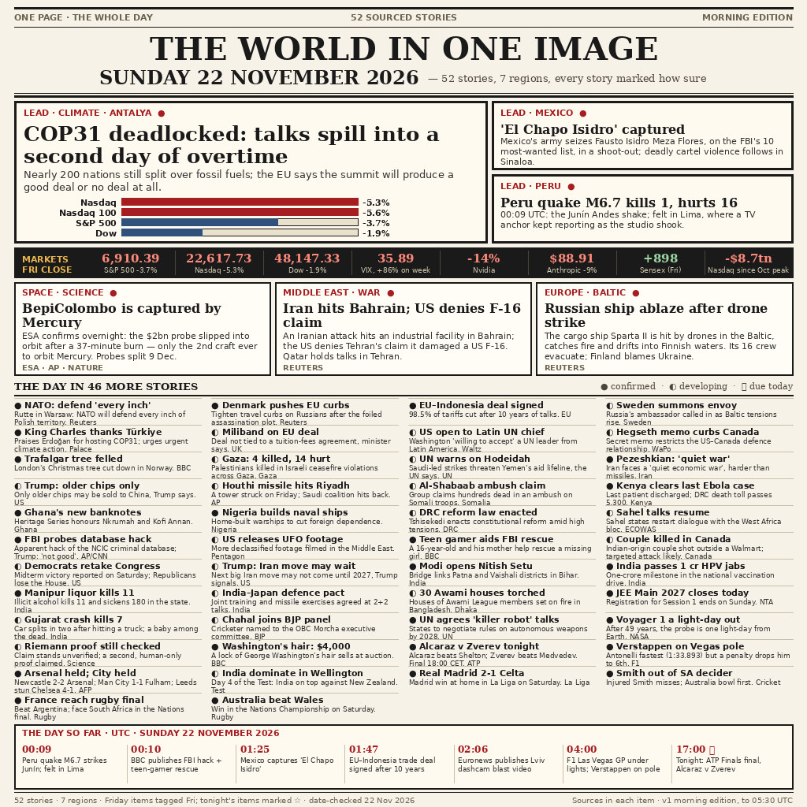

# Sunday 22 November 2026: COP31 deadlocked, 'El Chapo Isidro' captured, Peru quake and 49 more stories

[](https://make.fun/c/news-image-20261122)
[](https://opensource.org/licenses/MIT)
[](https://www.python.org/)

Entry for the make.fun competition
[news-image-20261122](https://make.fun/c/news-image-20261122)
— "Sum up 22 November's world news in one image". One front page,
1024×1024 PNG, 52 sourced stories across 7 regions.



## What it is

A one-page newspaper front page for Sunday 22 November 2026, drawn
deterministically by `draw22.py` (pure Pillow, no network) and shipped
as `entry.png`. `main.py` (Python 3.13, standard library only) copies
`entry.png` to the grader's output directory; two runs write identical
bytes.

- **3 leads:** COP31 deadlocked into a second day of overtime; Mexico
  captures 'El Chapo Isidro'; Peru's M6.7 quake (00:09 UTC).
- **3 panels:** BepiColombo confirmed in Mercury orbit; Iran hits
  Bahrain; a Russian cargo ship ablaze in the Baltic.
- **46 more stories** in a dense grid — Europe, Middle East, Africa,
  the Americas, Asia-Pacific, tech & science, sport.
- **UTC timeline** (7 points) and a **markets strip** (Friday close,
  labelled as such).
- **Every story is marked how sure:** ● confirmed, ◐ developing,
  ☆ due today — plus its source and a date check. See
  `research-22nov.md` for the sourcing, the dating rule, and the items
  deliberately excluded as stale (e.g. the 12 Nov Nvidia resignation,
  the 19 Nov summit and ICJ ruling, the 20 Nov Lviv barrage itself).

## How it was built

1. Researched the day's news from reputable sources (Reuters, BBC,
   AP, USGS, ESA, AFP) via web search, morning edition to ~05:30 UTC.
2. Copied the winning formula of the 18 November edition
   ("saputra-perlindungan", win rate 0.858): ~51 sourced stories,
   3 named leads, 7 regions, UTC timeline, markets/data strip,
   front-page composition.
3. Beat it on: a confidence marker on every story, a date-checked
   note, the correct day (Sunday 22 November 2026), and 52 stories.

## Run it

```sh
python3 draw22.py            # rebuild entry.png (deterministic)
mkdir -p out && MAKEFUN_OUTPUT_DIR=out python3 main.py
```

## Validation

- `entry.png`: 1024×1024, 215,036 bytes (limit 1 MiB).
- `main.py` run twice produces byte-identical output (sha256 checked).
- 52 stories counted: 3 leads + 3 panels + 46 grid items; 7 regions.

## License

MIT — see `LICENSE`.
